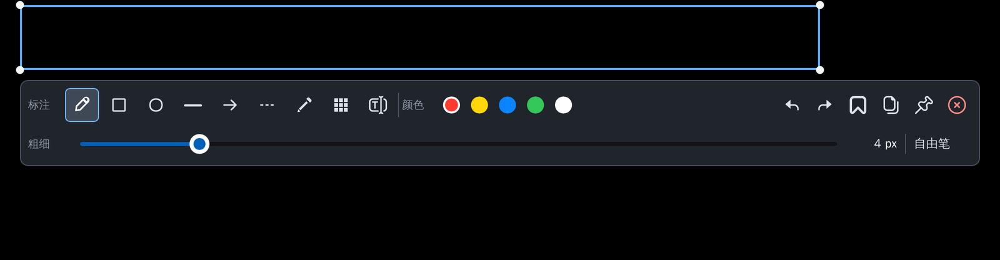
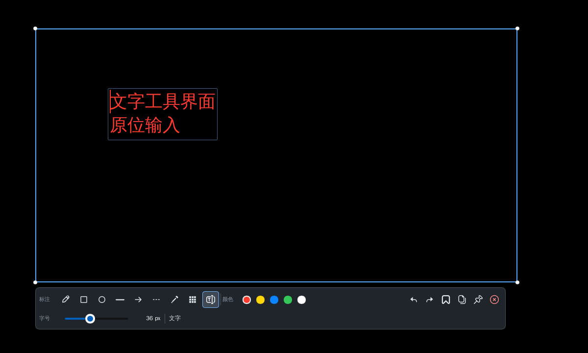
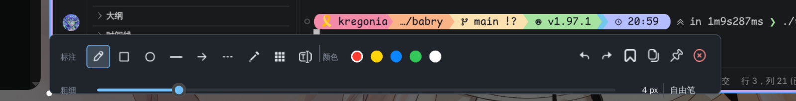

<div align="center">
  

  # Babry

  **一款为 Linux Wayland 打造的、懂边界的截图工具。**

  悬停吸附 · 单击确认 · 拖动精修 · 原位标注 · 一键复制

  <p>
    <a href="https://github.com/kregonia/babry/actions/workflows/cargo-linux-multiarch.yml"></a>
    <a href="https://github.com/kregonia/babry/blob/main/LICENSE"></a>
    <a href="https://www.rust-lang.org/"></a>
    <a href="https://aur.archlinux.org/packages/babry-bin"></a>
    <a href="https://github.com/kregonia/babry/stargazers"></a>
  </p>

  <p>
    <a href="#快速开始">快速开始</a> ·
    <a href="#为什么是-babry">为什么是 Babry</a> ·
    <a href="#交互方式">交互方式</a> ·
    <a href="#开发者">开发者</a>
  </p>
</div>

<br>

<div align="center">
  
</div>

## 为什么是 Babry

传统截图工具通常让你在“手动框选”和“调用桌面环境原生选择器”之间二选一。Babry 走第三条路：**截取整屏后，用本地 CV 结合边缘、色差和布局分析候选区域，在鼠标悬停时给出选区。**

你可以：

- **悬停就吸附**到窗口、面板、卡片或控件；
- **滚轮换层级**，在控件、面板、窗口和全屏之间切换；
- **单击就确认**，不需要反复调整边框；
- **拖动就精修**，任何时候都能切换为像素级手动框选；
- 在同一个界面完成标注、文字、复制、保存和贴图。

> [!NOTE]
> Babry 当前支持 Linux Wayland 下的 niri、Hyprland 和 KDE Plasma 6.8+。原生编辑器使用 SCTK、Layer-Shell 与 wl_shm；截图像素只在共享内存中保留一份，同时用于显示和导出。

## 预览

### 智能选区与编辑器

<div align="center">
  
</div>

悬停目标区域时，Babry 会显示候选框、尺寸和四角控制点；进入编辑后，选区外区域自动变暗，视觉焦点留在需要保存的内容上。

### 原位文字输入

<div align="center">
  
</div>

文字工具参考 PixPin 的输入体验：点击画布后直接输入，文字显示在原位置；字号和颜色在工具栏实时调整，输入效果与最终导出保持一致。

### 工具栏细节

<div align="center">
  
</div>

工具栏提供矩形/圆形/方形、画笔、文字、递增数字标注、马赛克/高斯模糊、橡皮擦、荧光笔、撤销/重做、贴图、保存和复制。形状和效果可从右侧箭头打开菜单切换，左侧点阵用于拖动工具栏。

## 功能一览

| 能力 | 体验 |
| --- | --- |
| **CV 智能选区** | 先按 IPC 窗口几何定位，再在每个窗口内以原生分辨率分析；分隔线行/列、纯色连通域与连续边框，原图边界精修、滚轮切换父/子层级 |
| **全屏截图** | `zwlr_screencopy`（niri/Hyprland）或 KWin 截屏接口（KDE Plasma 6.8+）获取当前 Wayland 桌面，`--screen` 直接进入编辑 |
| **标注工具** | 画笔、矩形/圆形/方形、圈号递增数字标注、橡皮擦和半透明荧光笔 |
| **隐私处理** | 局部马赛克与连续轨迹模糊，可调节模糊度 |
| **原位文字** | 直接在画布输入，多行换行，支持 text-input-v3 输入法；字号、字体和颜色与导出同步 |
| **工作流** | 实时预览、撤销/重做、保存 PNG、复制到剪贴板、Wayland 贴图 |
| **轻依赖** | Rust + SCTK + wl_shm + tiny-skia；不需要 grim、Slint、系统 OpenCV、slurp 或 niri 选区命令 |

## 快速开始

### 1. 安装 Babry

Arch Linux 及其衍生发行版用户可以通过 AUR 安装二进制包 [babry-bin](https://aur.archlinux.org/packages/babry-bin)，无需本地编译 Rust：

```bash
yay -S babry-bin
# 或
paru -S babry-bin
```

如果已配置提供 `babry-bin` 的二进制软件仓库，也可以使用：

```bash
sudo pacman -S babry-bin
```

`pacman` 不直接从 AUR 安装软件；仅使用 AUR 时，请选择上面的 `yay` 或 `paru` 命令。

<details>
<summary>从源码构建</summary>

安装 Rust 工具链及对应发行版的构建依赖后执行：

```bash
git clone https://github.com/kregonia/babry.git
cd babry
cargo build --release --locked
```

生成的二进制文件为 `target/release/babry`。将它放入 `PATH`：

```bash
install -Dm755 target/release/babry ~/.local/bin/babry
```

</details>

### 2. 安装运行依赖

截图由 Babry 直接通过 Wayland 协议完成：niri/Hyprland 使用 `zwlr_screencopy`，KDE Plasma 6.8+ 调用 KWin 自带的 `org.kde.KWin.ScreenShot2`，都不需要 `grim`。复制图片需要 `wl-clipboard`；可选的 `notify-send` 用于状态通知。AUR 包已声明 Fontconfig、xkbcommon 和 Wayland 系统库依赖。

Arch Linux：

```bash
yay -S wl-clipboard libnotify
```

### 3. 开始截图

```bash
babry                  # CV 智能区域截图：悬停吸附，单击确认
babry --smart          # 同上，显式使用智能选区
babry --screen         # 截取全屏并直接进入编辑
babry --pin image.png  # 将已有 PNG 作为屏幕贴图
babry --output DP-1 --screen # 指定显示器截图
babry --list-outputs   # 列出当前会话的显示器信息
babry --help           # 查看完整帮助
```

`--window` 和 `-w` 仍作为兼容别名保留，但现在使用 Babry 自己的 CV 选区，不启动 niri 的交互式选择器；只向 niri IPC 查询窗口矩形和焦点顺序。

### 图片保存目录

未配置时，图片保存到 `XDG_PICTURES_DIR` 环境变量指定的目录，否则使用 `~/Pictures`；没有 `HOME` 时使用当前目录。文件名为 `babry-年月日-时分秒-毫秒.png`。保存、复制和贴图都会先在此目录生成 PNG。

持久设置可写入 `~/.config/babry/config.toml`；设置了 `XDG_CONFIG_HOME` 时，改用 `$XDG_CONFIG_HOME/babry/config.toml`。示例见 [config.example.toml](docs/config.example.toml)：

```toml
save_dir = "~/Pictures/Screenshots"
```

单次指定或通过环境变量覆盖：

```bash
babry --save-dir ~/Pictures/Work
babry --screen --save-dir "/mnt/data/我的截图"
babry --standalone --output DP-1 --save-dir ./screenshots
BABRY_SAVE_DIR=~/Pictures/Babry babry
```

优先级为 **`--save-dir` → `BABRY_SAVE_DIR` → 配置文件 `save_dir` → `XDG_PICTURES_DIR` → `~/Pictures`**。配置值支持 `~/`、`$HOME/`、`${HOME}/`；配置中的相对路径以配置文件所在目录为基准，命令行和环境变量中的相对路径以本次调用的工作目录为基准。目录只在实际导出时创建；创建或写入失败会报告错误并保留编辑窗口。

后台模式每次截图由调用端重新读取配置并传递保存目录，修改配置无需重启后台，临时 `--save-dir` 不会改变后续截图的默认目录。配置文件不会自动创建或覆盖。

### 常驻后台加速唤起

在图形会话中先启动一次后台：

```bash
babry --daemon
```

该命令在前台运行，可由合成器管理。后台启动后，原有的 `babry`、`babry --screen` 和 `--output NAME` 截图命令会通过当前 Wayland 会话的 Unix socket 唤起它，无需修改截图快捷键。每次请求都会获取新截图；已有截图正在选择或编辑时，重复请求会提示忙碌，不覆盖当前内容。保存、复制、贴图、取消或关闭编辑窗口后，后台释放该次截图、标注历史和 CV 候选，继续等待。Pin 仍运行在独立进程中。

```bash
babry --daemon-status          # 查看当前会话的后台状态
babry --stop-daemon            # 退出后台（同时关闭尚未完成的编辑窗口）
babry --standalone             # 本次跳过后台，截图结束后退出
babry --standalone --screen    # 独立全屏截图，可继续组合 --output
```

后台未运行时，普通截图命令自动按独立模式执行，不强制常驻。后台模式下，命令返回表示截图请求已接收；后续截图失败通过通知和后台 stderr 报告。

niri 可在配置顶层加入：

```kdl
spawn-at-startup "babry" "--daemon"
```

Hyprland 可加入：

```ini
exec-once = babry --daemon
```

常驻后台只监听 Unix socket；截图编辑会话按请求启动并在保存/取消后退出，因此不会在空闲状态初始化 Wayland surface、字体或绘图缓冲区。

## 交互方式

### 选区阶段

1. 移动鼠标：从已缓存的候选中选择边界可靠的区域，微小移动保持当前框。
2. 滚轮向上：扩大到父区域；向下：缩小到鼠标所在的子区域。
3. 单击：确认当前候选，包括滚轮选择的层级，进入编辑阶段。
4. 按住拖动：移动超过 3px 后切换为手动框选；松开后确认区域。
5. 确认选区后，拖动边框或角点微调大小；选区阶段拖动始终进入手动框选，避免智能候选边缘抢走操作。
6. `Esc`：取消截图。

CV 分析在每次截图时由后台线程执行一次，悬停不会重新处理整张图像；等待期间可以直接拖动框选。

分析分两层：

1. **整屏**：按最长边缩到 800px，统计连续边缘线和纯色连通域，保留桌面、面板和跨窗口的大区域。
2. **每个窗口**：以合成器给出的窗口矩形为边界，按窗口自身尺寸重新缩放到最长边 768px。同一个 60px 按钮在整屏分析里可能只剩 18px，在窗口分析里仍有 35px，因此按钮、输入框、列表行才能成为候选。

窗口内额外用相邻长分隔线生成整宽行和整高列，覆盖工具栏、列表行、侧栏和分栏；贴着窗口边框的区域也把边框当作真实边缘。焦点窗口作为首帧默认选区，悬停其他窗口时再选择该窗口内的具体控件。

niri 26.04 的 IPC 不返回平铺窗口的 `tile_pos_in_workspace_view`（只有浮动窗口和新版 niri 才返回）。Babry 用列/行索引、`tile_size`、焦点列居中和列间距重建可见几何，再在整屏范围搜索焦点窗口的真实位置；宽高始终采用 IPC 的权威值，只修正平移。新版 niri 返回精确位置时直接使用。

选区评分优先考虑方向边界的连续性，降低文字碎片和不规则纹理的优先级；高分屏候选会在原始截图上精修边界。

### 编辑阶段

- **默认状态**：确认选区或使用 `--screen` 后，标注工具均不选中，拖动选区内部整体平移。
- **工具切换**：点击工具启用对应标注；再次点击同一工具取消选择并恢复选区移动。工具栏没有额外的“编辑”“移动”按钮。
- **调整大小**：四个角点和四条边始终可以拖动调整选区，任何工具状态均有效；悬停显示横向、纵向或对角缩放光标。
- **移动工具栏**：按住最左侧点阵并拖动，只改变工具栏位置，不改变选区或当前工具。
- **形状**：矩形右侧下拉可切换矩形、圆形和方形；圆形/方形保持像素宽高一致。
- **粗细**：画笔等工具下方的滑块和数字输入框共用 1～64px 粗细值。
- **数字标注**：点击选区添加圈 1、圈 2……；撤销和重做同步恢复编号。
- **橡皮擦**：沿笔迹还原原截图像素，擦除也支持撤销/重做。
- **隐私效果**：马赛克右侧下拉可切换高斯模糊。
- **长截图**：工具栏最右侧按钮。选区外显示一圈边框和控制条，选区内照常用滚轮或键盘向下滚动页面，点“完成”保存 PNG 并复制到剪贴板。吸顶标题栏和底部固定栏只保留一份；滚得太快导致前后两帧没有重叠时控制条会提示，往回滚一点即可接上。只支持向下滚动，结果高度上限 40000 px。
- **预留功能**：折线、录屏、OCR、翻译尚未实现，不显示在工具栏。
- **文字**：选择 `字` 工具，在选区内点击即可原位输入。
- **确认文字**：点击画布外、切换工具或按 `Ctrl+Enter`。
- **取消文字**：`Esc` 放弃正在输入的文字；不在输入时，`Esc` 依次关闭菜单、取消当前绘制、取消选中工具，最后关闭截图。
- **字号/颜色**：输入过程中也可以从工具栏实时修改；颜色圆点旁的彩虹按钮可展开默认色盘，选择更多彩色、灰阶和常用预设色。
- **历史**：`Ctrl+Z` 撤销，`Ctrl+Shift+Z` 或 `Ctrl+Y` 重做。
- **导出**：`Ctrl+S` 保存，`Ctrl+C` 复制，工具栏上的图钉用于贴图。

### 贴图阶段

通过工具栏的贴图按钮，Babry 会把当前选区导出后在独立进程中以 Wayland layer-shell Top layer 显示，编辑器随即退出并释放整张截图。贴图图像逐行解码进共享内存，缩放只改变 `wp_viewport` 目标尺寸，不在 CPU 上重采样：

- 左键拖动：移动贴图
- 拖动四边或四角：调整贴图尺寸（最小 64px）
- 滚轮：以中心为锚点缩放贴图
- 右键：关闭贴图
- `Esc`：关闭获得焦点的贴图

## 合成器与多显示器

Babry 会根据 `XDG_CURRENT_DESKTOP` 与合成器环境变量（`NIRI_SOCKET`、`HYPRLAND_INSTANCE_SIGNATURE`、`KDE_FULL_SESSION`）选择 niri、Hyprland 或 KDE Plasma 6.8+，读取每个显示器的名称、逻辑位置、逻辑尺寸和缩放比例。

```bash
babry --list-outputs
babry --output DP-1 --screen
babry --output DP-1 --pin image.png
```

`--output NAME` 可以与截图或贴图命令组合。显示器名称、逻辑位置和尺寸通过 Wayland `wl_output`/`xdg_output` 读取，分数缩放由当前 mode 的物理尺寸除以逻辑尺寸推导；焦点显示器通过 niri/Hyprland 的 IPC socket 或 KWin 的 `org.kde.KWin.activeOutputName()` 查询。默认只截取焦点显示器：niri/Hyprland 使用 `zwlr_screencopy` 把像素直接写入共享内存，KDE 调用 KWin 的 `org.kde.KWin.ScreenShot2` D-Bus 接口（返回原始像素，不经过 XDG Portal；Plasma 6.8 起无需额外桌面文件声明）。编辑覆盖层绑定到被截取的显示器。无法获取焦点时使用第一个启用的显示器；指定不存在的显示器会报错。

当前截图按指定显示器单独捕获，贴图初始尺寸也按目标显示器的逻辑尺寸和缩放计算。跨显示器拖动、把同一张贴图动态迁移到另一块输出，以及不同输出间的实时 layer-shell 重绑定仍在完善中。

### KDE Plasma 6.8+

- 截图走 KWin 自带的 `org.kde.KWin.ScreenShot2`（Spectacle 同款），像素经 pipe 直接读入共享内存。
- 编辑器使用 layer-shell 覆盖桌面和面板，不出现在任务栏或 Alt+Tab 中。中文输入期间临时切换到 Top 层，让 KWin 的输入法候选窗和状态提示显示在编辑器上方，结束输入后恢复 Overlay 层。
- Plasma 6.8 之前的 ScreenShot2 需要桌面文件声明 `X-KDE-DBUS-Restricted-Interfaces`，Babry 暂不支持这些版本。
- KWin 在锁屏/熄屏期间返回黑帧，属安全行为，与 XDG Portal 一致。

## niri 配置

编辑器和贴图都是 layer-shell 表面，不需要窗口规则。推荐快捷键：

```kdl
binds {
    Mod+Shift+S { spawn "babry"; }
    Mod+Shift+F { spawn "babry" "--screen"; }
}
```

## 字体配置

文字标注会优先使用 `BABRY_FONT` 指定的字体，并尝试系统中文字体。适合中文环境的示例：

```bash
export BABRY_FONT=/usr/share/fonts/wenquanyi/wqy-zenhei/wqy-zenhei.ttc
export BABRY_FONT_INDEX=0
babry
```

TrueType Collection（`.ttc`）可以通过 `BABRY_FONT_INDEX` 选择字体索引。输入阶段和导出阶段使用同一字体来源，减少“输入时一种字体、保存后另一种字体”的偏差。

## 技术路线

```text
Wayland 桌面
    │  zwlr_screencopy（niri/Hyprland）或 KWin ScreenShot2（KDE Plasma 6.8+）
    ▼
memfd 共享内存截图 ──────────────┐  唯一的整屏像素副本
    │                            │
    ├─ 后台线程：智能选区分析     │
    ▼                            ▼
layer-shell 主表面直接显示截图  导出时按 64 行条带合成标注
    │                            │
    ├─ 子表面：遮罩、边框、手柄（1×1 纯色缓冲区 + 视口拉伸）
    ├─ 子表面：工具栏、菜单、尺寸标签（小块双缓冲）
    └─ 子表面：约 256 物理像素见方的标注瓦片（按需分配，空闲页归还）
                                 │
                                 ▼
                     PNG 保存 / 剪贴板 / 贴图进程
```

指针移动只改变子表面的位置和视口尺寸，不重绘整帧，合成器也不重新上传整张截图。界面以输出的物理分辨率绘制，分数缩放下文字和图标保持清晰。标注历史只保存矢量命令；显示瓦片和导出使用同一套 tiny-skia 绘制，马赛克、模糊和橡皮擦按历史顺序作用于“原图 + 之前的标注”。

### 项目结构

```text
src/
├── cli.rs              # 命令解析与帮助文本
├── compositor.rs       # 合成器检测、输出元数据与窗口锚点
├── config.rs           # 保存目录配置、路径展开与导出文件名
├── daemon.rs           # 会话 Unix socket、实例锁和后台子进程
├── editor.rs           # 编辑器状态机：选区、工具、文字输入法、快捷键、导出
├── export.rs           # 条带合成与流式 PNG 编码
├── font.rs             # 按需 mmap 字体与 ttf-parser 轮廓
├── kde.rs              # 按需加载 sd-bus 的 KWin ScreenShot2
├── marks.rs            # 标注命令与 tiny-skia 光栅化
├── native_icons.rs     # 工具栏 SVG 图标几何
├── native_pin.rs       # layer-shell 贴图
├── native_ui.rs        # 工具栏、菜单、色盘的布局、命中测试与绘制
├── pixels.rs           # 普通内存 RGBA 像素
├── scene.rs            # 子表面场景、纯色平面与标注瓦片
├── screencopy.rs       # zwlr_screencopy 捕获到 memfd
├── shm_image.rs        # memfd 共享内存图像
├── smart_select.rs     # 智能选区检测与层级切换
├── core/               # 像素几何与撤销/重做历史
├── lib.rs              # 库模块导出
└── main.rs             # 命令分发、截图会话与后台
```

## 开发者

常用验证命令：

```bash
cargo fmt --all
cargo check --locked
cargo test --all-targets
cargo clippy --all-targets -- -D warnings
cargo build --release --locked
```

测试覆盖 CLI、保存目录配置、后台协议、memfd 图像的通道规范化与八种输出旋转/翻转、标注图层（橡皮擦顺序、图形内部透明、瓦片与整图渲染的效果一致性）、分数缩放瓦片边界、跨条带的流式 PNG 导出、智能选区的层级切换、窗口种子平移、无位置假设的焦点窗口定位与窗口内小控件检测，以及贴图边缘判定。

真实 Wayland 回归测试位于 `tests/wayland_editor.rs`，会发送鼠标和按键事件，因此默认忽略。请在专门的 KDE/niri 测试会话中串行执行：

```bash
BABRY_TEST_ARTIFACTS=/tmp/babry-wayland-tests \
  cargo test --test wayland_editor -- --ignored --test-threads=1 --nocapture
```

测试检查长笔画跨瓦片连续性、矩形缩回后无旧轮廓、预览与 PNG 中的标注位置、手动选区、工具菜单、复制 PNG、贴图和 Esc。niri 上另有一项测试用真实 `niri msg` 窗口几何验证首帧选中焦点窗口，并悬停另一个窗口内的小控件后导出对应尺寸。KDE 上还使用 fcitx5 拼音输入，检查候选框可见与中文导出。KWin 可用 `KWIN_DISABLE_UDMABUF_IMPORT=0` 启动以覆盖共享内存 DMA-BUF 导入路径；`BABRY_TEST_BINARY` 可指定旧版二进制验证回归测试确实能够复现故障。

### 启动与内存

设置 `BABRY_TRACE=1` 后，stderr 会输出截图、智能选区和首帧呈现（收到第一次 frame callback）的耗时：

```bash
BABRY_TRACE=1 babry --standalone
```

在 niri、2560×1440、1.25 倍缩放、3 个可见窗口的 Release 构建上实测：截图约 66ms，编辑器首帧在其后约 65ms 呈现，智能选区在后台约 133ms 完成（整屏约 41ms，其余为窗口内分析，随可见窗口数量增长）。进程常驻内存（`/proc/PID/status` 的 VmRSS）在选区阶段约 23MB，峰值约 27MB，其中 14.4MB 是截图共享内存；画了画笔、圆形、马赛克、序号、文字、模糊和橡皮擦后约 28MB。4K 截图本身需要 33MB。这些是单机测量，不同合成器、窗口数量和标注范围会有差异。

### 检查 CV 选区

对已保存的截图运行离线诊断，无需启动 Wayland 截图窗口：

```bash
babry --debug-selection screenshot.png /tmp/babry-cv-debug
```

输出目录包含：

- `candidates.png`：所有保留候选；绿色表示质量评分至少 0.72，红色表示较弱的候选。
- `candidates.json`：矩形、质量评分、是否为窗口种子、是否为焦点窗口以及分析耗时。

如果当前桌面尺寸与图片一致，诊断会读取真实窗口几何并执行与正式截图相同的两层分析；否则只做整屏分析。设置 `BABRY_TRACE_SELECTION=1` 可在 stderr 查看窗口种子。

评分用于启发式排序，不是识别正确率。原图、鼠标位置和期望选区可以一起用于复现误判。

## 当前边界

- CV 识别不到明确边界时会回退到全屏，仍可拖动鼠标精确框选。
- 编辑器和贴图需要合成器支持 `wp_viewporter`；niri、Hyprland 和 KWin 均支持。
- 输入法预编辑依赖合成器转发 `text-input-v3`；不支持时仍可直接键入。
- 跨显示器拖动 Pin、OCR、贴图持久化尚未实现；长截图暂不支持向上或横向滚动，标注也不会带入长截图。

## 参与贡献

欢迎提交 Issue、改进建议和 Pull Request。特别欢迎：

- 不同 Wayland 合成器上的兼容性反馈；
- 中英文、日韩文字体的渲染样例；
- CV 选区误判截图与可复现图片；
- 新标注工具和更顺手的快捷键设计。

如果 Babry 对你的工作流有帮助，欢迎点一个 ⭐，它会帮助项目被更多 Wayland 用户发现。

## License

[Apache License 2.0](LICENSE)
